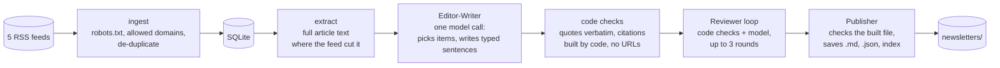

# daily-digest

A command-line tool that reads the day's AI news from RSS feeds and writes one short, cited briefing for enterprise AI leaders. Every fact, quote and attributed view is cited to the article it came from, quotes are checked word for word, and a second pass reviews the draft against its sources before anything is saved.

**Status:** v1, runs locally from the command line, one person, five feeds, text only. It is a working build, not a service. See [Limits](#limits) for what is not done.

## What you get

A Markdown file per day with a headline, two short sections ("What you need to know" and "Worth a closer look"), numbered citations like `[1]`, and a Sources list with title, publisher, date and link. A final line says how it was reviewed. On a light day (a few items) the digest is shorter and says so ("Light day: 4 items today").

## How it works



1. **Ingest and extract** read the feeds and fetch article text, respecting `robots.txt` and only following links on each feed's own domains.
2. **The Editor-Writer** makes one model call. It reads the day's items, chooses what matters for the audience, and returns structured sentences, each labelled (fact, quote, attributed opinion, trend, transition) with the items that support it.
3. **Code checks the reply.** A quote must appear word for word in its source, a named speaker must appear in the item, the model may not write URLs, and citation numbers and the Sources list are built by code, never by the model.
4. **The Reviewer** checks each sentence against the sources it cites, for up to 3 rounds. Approval is decided by code: a draft is approved only when no blocking issue is left from either the code checks or the model. If it cannot converge, code removes the flagged sentences instead of asking again. A headline cannot be fixed by removing a sentence, so when the headline is the only problem left it gets one targeted rewrite, checked once; if that fails, or a draft is too short once the flagged sentences are gone, nothing is saved.
5. **The Publisher** checks the finished file once more, writes it so a crash cannot leave half a digest, and records the day's items as used.

## Design choices that matter

- **Everything fetched is untrusted.** Feed text and articles go into the model only inside delimited data blocks, with hidden characters removed and angle brackets neutralised. The model has no tools. See [`docs/SECURITY.md`](docs/SECURITY.md) for what is defended and what is not.
- **The model proposes, code decides.** Verdicts, citation numbers, the Sources list and the file structure come from code, and a model's "approve" cannot override a code check (URLs, quotes, opinion patterns, length). The sentences themselves are written by the model, and whether a plausible sentence is really supported by its source is judged by the model Reviewer, so a person should still read the digest.
- **Spending is capped in dollars.** A run stops at $0.25, and at 80% it stops starting new review and revision calls and finishes in code. The cap, token ceilings and prices are in `config/settings.toml`.
- **Quality is measured, not assumed.** An eval suite runs the whole pipeline on saved cases and has a second model score the results. See [Evals](#evals) for how to run it and [`docs/EVAL_REPORT.md`](docs/EVAL_REPORT.md) for the first results.

## Quick start

```
uv sync
uv run pytest                              # offline: mock model, saved feed fixtures, no key
uv run daily-digest draft --stub           # offline placeholder summaries, no key
```

To use a real model you need an Anthropic API key (see [Your API key](docs/SECURITY.md#your-api-key) for creating one, setting a spend limit and keeping the key out of your shell history). On macOS, with the key stored in the keychain:

```
ANTHROPIC_API_KEY=$(security find-generic-password -a "$USER" -s daily-digest-anthropic -w) uv run daily-digest run
```

On other systems, put the key in `ANTHROPIC_API_KEY` another way. `run` is the one daily command; [Daily use](#daily-use) says what it does and when it stops. Use `draft` to preview a day without saving anything.

## Configuration

| File | What is in it |
|---|---|
| `config/feeds.toml` | The feeds, and the domains each one may link to |
| `config/settings.toml` | Model and prices, dollar and token caps, review rounds, the light-day rules |
| `evals/rubric.toml` | What the eval judge scores |

## Limits

- **Local and manual.** There is no scheduler, no web page and no email. You run a command and read a file.
- **Five English-language feeds, text only.** More sources and audio are future work.
- **It can produce nothing.** Rather than publish something it cannot verify, it fails closed: a digest that does not pass review or the final check is not saved.
- **Output varies between runs.** The same day can be approved in one run and fail in the next, and which stories are picked can change.
- **Short days are short.** With 3 to 7 items the digest aims for about 100 words (as few as 50) and is labelled; with fewer than 3 there is no digest.
- **Known open problems** are listed in [`docs/EVAL_REPORT.md`](docs/EVAL_REPORT.md) and the issue tracker.
- **Not reconciled:** dollar figures come from the API's token counts and a price table, and have not been compared with the provider's billing page.

## Tests and CI

Over 600 tests run offline with a mock model and saved fixtures; CI never has an API key and never calls a paid model. CI also scans every pull request and every push to `main` for committed secrets with Gitleaks.

## Layout

```
src/daily_digest/   pipeline: ingest, extract, editor (Editor-Writer), reviewer, publisher, evals, llm client
config/             feeds and settings
docs/               PRD (what and why), DESIGN (how), SECURITY, EVAL_REPORT
evals/              rubric, invented cases, baseline scores
tests/              offline tests and fixtures
```

Read `docs/PRD.md` (what and why) and `docs/DESIGN.md` (how) before changing behaviour.

MIT licensed.

## Daily use

One command runs everything:

```
ANTHROPIC_API_KEY=... uv run daily-digest run [--date YYYY-MM-DD] [--out-dir PATH]
```

`run` does `ingest`, then `extract`, then `generate`. It exits early, with nothing spent, if the day's digest already exists, and it tells you when a failure is worth retrying. The stop and exit rules are in [`docs/DESIGN.md`](docs/DESIGN.md) ("The run command").

## Commands

```
uv run daily-digest ingest                    # read the feeds into the local database
uv run daily-digest extract [--days N]        # fetch full text (only from each feed's allowed domains) for items whose feed text is short or cut
uv run daily-digest draft --stub              # offline placeholder summaries; no key needed
uv run daily-digest draft [--date YYYY-MM-DD] # write the day's digest and review it; prints it, a review line and a usage line
uv run daily-digest draft --debug             # also log every model call and review round (counts and dollars, never text or keys)
uv run daily-digest draft --no-review         # skip the Reviewer: marked NOT REVIEWED, exit code 3
uv run daily-digest generate [--date YYYY-MM-DD] [--out-dir PATH]   # make the digest for real: review, save, mark its items seen
```

- **Light days.** With 3 to 7 items the digest aims for about 100 words (as few as 50) and carries a "Light day" line; fewer than 3 items give no digest. Settings: `low_volume_max_items`, `low_volume_aim_words`, `low_volume_min_words` in `config/settings.toml`.
- **Saved files.** `generate` writes `newsletters/YYYY-MM-DD.md`, a `.json` with the provenance of every sentence, and `index.md`. It never overwrites a digest, and `newsletters/` is git-ignored because digests quote articles. How review statuses, saving and the seen-items ledger work is in [`docs/DESIGN.md`](docs/DESIGN.md).
- **Exit codes.** `draft`: `0` reviewed digest or nothing to write, `1` error or unrepairable draft, `2` setup problem, `3` not reviewed. `generate`: `0` saved, already exists, or nothing to write; `1` error, a failed check or a ledger failure; `2` setup problem (no key, bad settings, missing database, bad `--date`); `3` not reviewed, nothing saved. `run` exits with `generate`'s code.

## Evals

`eval` runs the whole pipeline on saved cases and has a second model score the digests, so a change to the model, a prompt or the rubric can be judged by numbers. How it works and what it measures is in [`docs/PRD.md`](docs/PRD.md) (section 7) and [`docs/DESIGN.md`](docs/DESIGN.md); first results are in [`docs/EVAL_REPORT.md`](docs/EVAL_REPORT.md).

```
uv run daily-digest eval run --mock                      # scripted replies: no key, no cost (checks the plumbing only)
uv run daily-digest eval snapshot --date YYYY-MM-DD      # export a real day from your database as a local case (no model call)
uv run daily-digest eval run [--limit N] [--cases ID,ID] [--category NAME] [--no-judge] [--judge-model ID]
uv run daily-digest eval report RUN_ID                   # table, the weakest 3 cases, problem types, pipeline rates, cost
uv run daily-digest eval baseline RUN_ID [--force]       # record the run's scores in evals/baseline.json
uv run daily-digest eval compare RUN_ID [--to baseline|RUN_ID]
uv run daily-digest eval spot-check RUN_ID [--n 5]       # random digests beside their sources, with a blank rating line
```

A real run needs `ANTHROPIC_API_KEY` and costs money: run `eval run --limit 3` first and read the cost per case. Results go to `evals/results/` (git-ignored); the 9 committed cases are invented, and real snapshots stay local because they hold article text from other sites. Each case runs once, so treat small score changes as noise, and read a few digests yourself with `spot-check` before trusting the judge.

## API key and cost

The app reads the key only from the `ANTHROPIC_API_KEY` environment variable and never stores, prints or logs it. Create a dedicated key, set a spend limit, and keep it out of your shell history: see [`docs/SECURITY.md`](docs/SECURITY.md#your-api-key). A run is capped at $0.25 (one call is typically 2 to 4 cents); the cap, token ceilings and prices are in `config/settings.toml` and explained in [`docs/DESIGN.md`](docs/DESIGN.md). CI scans for committed secrets with Gitleaks; to scan locally, see [Secret scanning](docs/SECURITY.md#secret-scanning).
