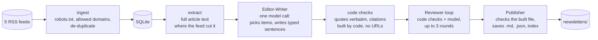

# daily-digest

A command-line tool that reads the day's AI news from RSS feeds and writes one short, cited briefing for enterprise AI leaders. Every fact, quote and attributed view is cited to the article it came from, quotes are checked word for word, and a second pass reviews the draft against its sources before anything is saved.

**Status:** v1, runs locally from the command line, one person, five feeds, text only. It is a working build, not a service. See [Limits](#limits) for what is not done.

## What you get

A Markdown file per day with a headline, two short sections ("What you need to know" and "Worth a closer look"), numbered citations like `[1]`, and a Sources list with title, publisher, date and link. A final line says how it was reviewed. On a light day (a few items) the digest is shorter and says so ("Light day: 4 items today").

## How it works



1. **Ingest and extract** read the feeds and fetch article text, respecting `robots.txt` and only following links on each feed's own domains.
2. **The Editor-Writer** makes one model call. It reads the day's items, chooses what matters for the audience, and returns structured sentences, each labelled (fact, quote, attributed opinion, trend, transition) with the items that support it.
3. **Code checks the reply.** A quote must appear word for word in its source, a named speaker must appear in the item, the model may not write URLs, and citation numbers and the Sources list are built by code, never by the model.
4. **The Reviewer** checks each sentence against the sources it cites, for up to 3 rounds. Approval is decided by code: a draft is approved only when no blocking issue is left from either the code checks or the model. If it cannot converge, code removes the flagged sentences instead of asking again. Two cases are not repaired this way and save nothing: a blocking issue on the headline (removing a sentence cannot fix it), and a draft that is too short once the flagged sentences are gone.
5. **The Publisher** checks the finished file once more, writes it so a crash cannot leave half a digest, and records the day's items as used.

## Design choices that matter

- **Everything fetched is untrusted.** Feed text and articles go into the model only inside delimited data blocks, with hidden characters removed and angle brackets neutralised. The model has no tools. See [`docs/SECURITY.md`](docs/SECURITY.md) for what is defended and what is not.
- **The model proposes, code decides.** Verdicts, citation numbers, the Sources list and the file structure come from code, and a model's "approve" cannot override a code check (URLs, quotes, opinion patterns, length). The sentences themselves are written by the model, and whether a plausible sentence is really supported by its source is judged by the model Reviewer, so a person should still read the digest.
- **Spending is capped in dollars.** A run stops at $0.25, and at 80% it stops starting new review and revision calls and finishes in code. The cap, token ceilings and prices are in `config/settings.toml`.
- **Quality is measured, not assumed.** An eval suite runs the whole pipeline on saved cases and has a second model score the results. See [Evals](#evals) for how to run it and [`docs/EVAL_REPORT.md`](docs/EVAL_REPORT.md) for the first results.

## Quick start

```
uv sync
uv run pytest                              # offline: mock model, saved feed fixtures, no key
uv run daily-digest draft --stub           # offline placeholder summaries, no key
```

To use a real model you need an Anthropic API key (see [Model access and cost](#model-access-and-cost) for creating one, setting a spend limit and keeping the key out of your shell history). On macOS, with the key stored in the keychain:

```
ANTHROPIC_API_KEY=$(security find-generic-password -a "$USER" -s daily-digest-anthropic -w) uv run daily-digest run
```

On other systems, put the key in `ANTHROPIC_API_KEY` another way. `run` is the one daily command; [Daily use](#daily-use) says what it does and when it stops. Use `draft` to preview a day without saving anything.

## Configuration

| File | What is in it |
|---|---|
| `config/feeds.toml` | The feeds, and the domains each one may link to |
| `config/settings.toml` | Model and prices, dollar and token caps, review rounds, the light-day rules |
| `evals/rubric.toml` | What the eval judge scores |

## Limits

- **Local and manual.** There is no scheduler, no web page and no email. You run a command and read a file.
- **Five English-language feeds, text only.** More sources and audio are future work.
- **It can produce nothing.** Rather than publish something it cannot verify, it fails closed: a digest that does not pass review or the final check is not saved.
- **Output varies between runs.** The same day can be approved in one run and fail in the next, and which stories are picked can change.
- **Short days are short.** With 3 to 7 items the digest aims for about 100 words (as few as 50) and is labelled; with fewer than 3 there is no digest.
- **Known open problems** are listed in [`docs/EVAL_REPORT.md`](docs/EVAL_REPORT.md) and the issue tracker.
- **Not reconciled:** dollar figures come from the API's token counts and a price table, and have not been compared with the provider's billing page.

## Tests and CI

Over 600 tests run offline with a mock model and saved fixtures; CI never has an API key and never calls a paid model. CI also scans every pull request and every push to `main` for committed secrets with Gitleaks.

## Layout

```
src/daily_digest/   pipeline: ingest, extract, editor (Editor-Writer), reviewer, publisher, evals, llm client
config/             feeds and settings
docs/               PRD (what and why), DESIGN (how), SECURITY, EVAL_REPORT
evals/              rubric, invented cases, baseline scores
tests/              offline tests and fixtures
```

Read `docs/PRD.md` (what and why) and `docs/DESIGN.md` (how) before changing behaviour.

MIT licensed.

## Daily use

One command runs everything:

```
ANTHROPIC_API_KEY=... uv run daily-digest run [--date YYYY-MM-DD] [--out-dir PATH]
```

`run` does `ingest`, then `extract` (reaching back to the digest day), then `generate`, and exits with `generate`'s code. Before doing any of that it checks whether the day's digest already exists (it then prints `ALREADY_EXISTS` and exits 0, with no fetching and no spend) and that the API key and settings work (exit 2). If any feed fails for a passing reason (network or server trouble) it stops before extract and the model, because the digest would be stale or have a hole that a saved digest makes permanent: exit 1, naming the feeds and saying a retry may work (nothing was saved, so running the same command again starts clean). A feed that fails for a lasting reason (robots.txt disallows it, it is not a valid feed) is skipped with a warning; if every feed is like that, or none is enabled, it stops with exit 2 and names them. Model errors in `generate` (and so in `run`) exit 1 and say whether a retry may help and what it could cost. If page fetching fails it carries on with feed text only and warns. The commands below are the same steps, for running or debugging one at a time.

## Evals

`eval` measures how good the digests are on saved cases, so a change to the model, a prompt or the rubric can be judged by numbers.

```
uv run daily-digest eval run --mock                      # whole suite on scripted replies: no key, no cost (checks the plumbing only)
uv run daily-digest eval snapshot --date YYYY-MM-DD      # export a real day from your database as a local case (no model call)
uv run daily-digest eval run [--limit N] [--cases ID,ID] [--category NAME] [--no-judge] [--judge-model ID]
uv run daily-digest eval report RUN_ID                   # table, the weakest 3 cases, problem types, pipeline rates, cost
uv run daily-digest eval baseline RUN_ID [--force]       # record the run's scores in evals/baseline.json (commit it)
uv run daily-digest eval compare RUN_ID [--to baseline|RUN_ID]
uv run daily-digest eval spot-check RUN_ID [--n 5]       # random digests beside their sources, with a blank rating line
```

The run id is the UTC time plus the git commit; results go to `evals/results/<run-id>/` (a digest, judge scores and notes per case, `results.json`, `summary.md`). A real run needs `ANTHROPIC_API_KEY`. The 9 committed cases are invented; real snapshots are git-ignored because they hold article text from other sites.

- **What the judge adds:** the pipeline already enforces citations, verbatim quotes, length and the no-opinion rules, and the eval does not recompute them. A second model (`claude-opus-5-5` by default, set under `[eval]` in `config/settings.toml` with its price) scores faithfulness, coverage, audience fit and concision from 1 to 5 against `evals/rubric.toml`, and flags unsupported sentences.
- **Cost:** a full run of about 9 digests plus judge calls is *estimated* at $1.20 to $1.60 (not yet measured: run `eval run --limit 3` first and read the cost per case). `max_usd_per_eval` (settings, default $2.00) caps generator and judge together: a case starts only if what is left covers a full pipeline cap and the dearest case so far, and the command prints what ran and exits 4 when it stops early.
- **When a case does not pass:** a case that ends `error`, `failed`, `not_converged`, `degraded` or `unreviewed` gets `failure.txt` (the same text `draft` prints, sanitised), `review.txt` (the draft and the issues of every review round), `draft.json` (the last draft the pipeline had before pruning) and `notes.txt` (each note once) in its folder. `results.json` records the failure text and `summary.md` shows it next to the status, so a failure can be diagnosed without paying for another run.
- **Canary check:** a case can list strings that must not appear in the digest (the injection case does). A hit fails the case and the command exits 1.
- **Reading a comparison:** each case runs once, so small score changes are noise. `compare` flags a drop of 0.5 or more in a dimension mean, a new canary hit or a new failed day, and says what changed in config, prompts and rubric. It exits 1 when it flags something.
- **Exit codes:** `0` done; `1` a canary hit or a flagged comparison; `2` a setup problem (no key, bad settings, rubric or case file, unknown id or run); `4` stopped by the eval cap.
- **Trust the numbers only after a human check:** run `eval spot-check`, read five digests next to the judge's scores, and see whether you agree.

## Commands

```
uv run daily-digest ingest                    # read the feeds into the local database
uv run daily-digest extract                   # (only from each feed's allowed domains in config/feeds.toml) fetch full text for items whose feed text is short, teaser-like or cut at the extract limit (--days N: how far back, default 2)
uv run daily-digest draft --stub              # offline placeholder summaries; no key needed
uv run daily-digest draft [--date YYYY-MM-DD] # writes the day's digest as Markdown, then a Reviewer checks it (at least two model calls)
uv run daily-digest draft --debug             # also log every model call and review round (counts and dollars, never text or keys) to stderr
uv run daily-digest draft --no-review        # skip the Reviewer: cheaper, but the digest is marked NOT REVIEWED and the exit code is 3
uv run daily-digest generate [--date YYYY-MM-DD] [--out-dir PATH]   # make yesterday's digest for real: review it, save it, mark its items seen
```

On a light day (at least 3 and fewer than 8 items, set by `low_volume_max_items` in `config/settings.toml`) the digest aims for about 100 words (`low_volume_aim_words`; the prompt asks for 80 to 120) and may be as short as 50 (`low_volume_min_words`, a hard minimum) instead of being padded to 200, and it says so with a line under the date: *Light day: 4 items today.* The saved JSON has `light_day` and `item_count`. Fewer than 3 items still gives no digest.

`draft` prints the digest (headline, two sections with `[n]` citations, a numbered Sources list), then any notes, then a usage line (calls, tokens in and out, dollars). The usage line prints on every exit, including errors. An illustrative run (numbers made up):

```
$ ANTHROPIC_API_KEY=... uv run daily-digest draft --date 2026-10-16
# Pilots reach production as governance lags

Covered 2026-10-16 · generated 2026-10-20 09:14 PDT · 2 min read

## What you need to know
...
## Sources

1. [Title](https://example.com/...) — Example Wire, 2026-10-16
usage: 1 call(s), 9,800 tokens in, 900 out, $0.0286
```

A day with fewer than three items makes no model call and prints a "No significant developments" note.

### Review

After the digest is written, a Reviewer checks each sentence against the sources it cites and asks for fixes, for up to 3 rounds (`max_review_rounds` in `config/settings.toml`). Approval is decided by code, never by the model: a draft is approved only when neither the code checks nor the model leave a blocking issue. A `review:` line follows the digest:

- `review: approved after 2 round(s)` - no blocking issue is left. Advisory issues are listed as bullets.
- `review: not converged after 3 round(s); 1 sentence removed` - a blocking issue survived every round, so code removed the flagged sentence and re-checked the rest. The removed sentences are listed as `unresolved` bullets.
- `review: degraded at 80% of the budget after 1 round(s); 1 sentence removed` - spending reached 80% of the $0.25 cap, so no further model call was started; the same removal was applied to the last draft the Reviewer judged.
- `review: NOT REVIEWED` - the Reviewer could not run (budget or an error) or you passed `--no-review`. The digest is printed under a banner and must not be published.
- `review: FAILED ...` - the draft could not be repaired (for example, removing a flagged sentence left it under the day's minimum length, or a blocking issue on the headline survived the last round: the headline cannot be fixed by removing a sentence, so it is never published as written). No digest is printed.

Exit codes: `0` a reviewed digest (approved, not converged or degraded) or nothing to write; `1` an error or a draft that could not be repaired; `2` a setup problem (no key, bad settings, missing database); `3` the digest was not reviewed. A review adds about 2 to 4 cents per round; most days should approve in one or two rounds.

### Generate

`generate` is `draft` made permanent. It runs the same pipeline (writer, then Reviewer), and if the digest passes a last check it saves three things and records the day's items as seen:

- `newsletters/YYYY-MM-DD.md` - the digest exactly as `draft` prints it, plus a final italic line saying how it was reviewed (for example `*Review: approved after 2 round(s).*`).
- `newsletters/YYYY-MM-DD.json` - the digest as data, plus a provenance record for every sentence (its type, the items behind it, the quote and speaker) and what the run cost. It holds no prompts and no key, and no article text beyond what the digest itself quotes (its notes can quote sentences that were dropped).
- `newsletters/index.md` - every saved digest, newest first, with a one-line preview. It is rebuilt from the saved files each time, so it heals itself if you delete one.

Every item the pipeline considered that day (not only the cited ones) goes into the seen-items ledger, but only after the files are saved, so a failed run never uses items up. `newsletters/` is git-ignored: digests quote articles and are your data. To show one publicly, copy it into `examples/` on purpose.

- **Date:** defaults to yesterday. `--date` must be earlier than today.
- **One digest per date, never overwritten.** If `newsletters/<date>.md` exists, `generate` prints `ALREADY_EXISTS: <path>` before reading the key or calling any model, and exits 0. There is no way to replace a digest in v1.
- **What gets saved:** `approved`, `not_converged` and `degraded` digests. A digest the Reviewer never judged (`unreviewed`, including `--no-review`) or could not repair (`failed`) is never saved and marks nothing as seen.
- **A last check before saving** looks at what code built from the draft: every `[n]` marker has a Sources entry and the other way round with numbers 1 to N, every Sources URL is one of that day's items, Sources titles are one line, and the text has no angle brackets, HTML or Markdown links. The words themselves were already checked by the Reviewer. A failure prints a fixed reason, saves nothing and exits 1.
- **A quiet day** (fewer than 3 items) saves nothing and exits 0.
- **Exit codes:** `0` saved, already exists, or nothing to write; `1` error, a draft that could not be repaired, a failed check, or a ledger that could not be updated (the files stay and the message says the next digest may repeat items); `2` setup problem (no key, bad settings, missing database, a bad `--date`); `3` not reviewed, nothing saved.
- **Cost:** the same as `draft`, since it runs the same pipeline. `draft` itself still saves nothing and writes no ledger rows.

## Model access and cost

`draft` without `--stub` calls the Anthropic API at least twice per run (the draft, then a review; each fix adds a revision call and another review). Model, prices, and caps live in `config/settings.toml`. The default hard cap is **$0.25 per run** (one call is typically 2 to 4 cents; a retry after a failed check can double it). Before each call the app estimates the worst case (about 2.7 characters per token plus the output format, calibrated on one real digest, which errs a little high for English but can undercount other text) and makes no call if the estimate would cross the cap; the real cost is computed from the usage the API returns. If an attempt times out or the connection drops after the request was sent, it may still have been billed, so the usage line counts it at the worst-case estimate and says so; the Console usage page is the source of truth for actual spend. A timed-out attempt reserves a full output allowance (6,000 tokens), so a second timeout usually ends the run because the next attempt would cross the $0.25 cap. Prices in the file are third-party-reported; check them against the [pricing page](https://platform.claude.com/docs/en/about-claude/pricing).

### 1. Create a key

1. Sign in to the [Claude Console](https://platform.claude.com/) and open the [API keys](https://platform.claude.com/settings/keys) page.
2. Click **Create key**, name it, and choose an expiration. Use a personal key for your own development.
3. Copy the key (it starts with `sk-ant-`). The Console shows it only once.

### 2. Set a spend limit as a second backstop

The app's cap stops a single run; a Console spend limit stops everything else. Limits cannot be set on the Default Workspace, so make a dedicated one.

1. On the [Workspaces](https://platform.claude.com/settings/workspaces) page, create a workspace (for example `daily-digest`) and create the key in step 1 scoped to it.
2. Select the workspace, click **Spend limits**, and set a monthly cap.

### 3. Keep the key out of your shell

The app reads the key only from the `ANTHROPIC_API_KEY` environment variable and never stores, prints, or logs it. Do not `export` it in your shell profile or type it into a command that lands in shell history.

On macOS, store it once in the login keychain. With `-w` last and no value, `security` prompts for it, so it never enters shell history:

```
security add-generic-password -a "$USER" -s daily-digest-anthropic -w
```

Then read it for a single run, so it exists only in that process:

```
ANTHROPIC_API_KEY=$(security find-generic-password -a "$USER" -s daily-digest-anthropic -w) uv run daily-digest draft
```

To remove it: `security delete-generic-password -a "$USER" -s daily-digest-anthropic`.

Without a key, `draft` exits with a one-line error; `draft --stub` needs none.

## Secret scanning

CI runs [Gitleaks](https://github.com/gitleaks/gitleaks) on the commits of every push to `main` and every pull request, and fails the build on a finding. A feature branch is covered once its PR is open. The job downloads a pinned release binary and checks it against a pinned sha256 taken from the release's published checksums file. It has read-only permissions, and CI uses no secrets or tokens at all (the tests use the mock LLM provider).

To scan locally on macOS, download the same release with `curl` (unlike a browser, it does not trigger Gatekeeper quarantine), check its sha256 (the command fails if it differs), and run the binary from where you extracted it. Use `arm64` on Apple silicon and `x64` on Intel:

```
V=8.30.1; ARCH=arm64   # or x64
case $ARCH in
  arm64) SUM=b40ab0ae55c505963e365f271a8d3846efbc170aa17f2607f13df610a9aeb6a5 ;;
  x64)   SUM=dfe101a4db2255fc85120ac7f3d25e4342c3c20cf749f2c20a18081af1952709 ;;
esac
curl -sSfL -o gitleaks.tar.gz "https://github.com/gitleaks/gitleaks/releases/download/v$V/gitleaks_${V}_darwin_$ARCH.tar.gz"
echo "$SUM  gitleaks.tar.gz" | shasum -a 256 -c -   # stops here if the hash differs
mkdir -p ~/bin/gitleaks-$V && tar -xzf gitleaks.tar.gz -C ~/bin/gitleaks-$V gitleaks
```

Then scan the whole history of every branch from the repo root. `--redact` keeps any secret out of the output:

```
V=8.30.1   # same version as above; set it again in a new terminal
~/bin/gitleaks-$V/gitleaks git --log-opts="--all" --redact .
```

The exit code is 1 when something is found and 0 when clean. To scan only what your branch adds, use `--log-opts="origin/main..HEAD"`. If you downloaded the archive in a browser instead, macOS may refuse to run it; `xattr -d com.apple.quarantine gitleaks` on the extracted binary fixes that.
