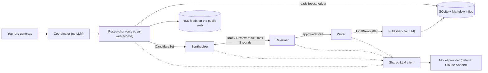

# DESIGN DOC: Daily Digest

> **Companion doc:** [PRD.md](PRD.md) defines what the product must do and why. This document describes how it is built. Requirement IDs (FR-x.y, NFR-n) refer to the PRD.

**Status:** v1 design for the Oct 15-23, 2026 build sprint. Local, CLI-first, human-triggered.

## 1. Overview and stack decisions

Daily Digest is a local Python application. A human runs `generate`; a Coordinator runs a multi-agent pipeline (Researcher, Synthesizer, Reviewer, Writer, Publisher) that turns the previous day's RSS items into one cited, source-grounded Markdown digest for enterprise AI leaders.

| Decision | Choice | Why |
|---|---|---|
| Language | Python 3.12+ | Best AI ecosystem; the owner is learning it; the reference project's Dockerfile also requires 3.12+ for current LangChain. |
| Orchestration | LangGraph | Shared typed state, loops (Synthesizer to Reviewer), checkpointing, and the pattern used by the reference project (gpt-researcher's multi-agent team). MIT license, widely used. |
| Contracts | pydantic | Schema validation on every handoff (NFR-1). |
| Storage | SQLite plus Markdown files | Simple, local, atomic writes; a path to Postgres exists if a service is built later. |
| Tests | pytest with fixtures and a mock LLM | Deterministic tests; no live sites or paid calls in CI. |
| LLM access | One `LLMClient` interface, Claude Sonnet default | Model-agnostic (NFR-11). |
| Hosting | Local only in v1; undecided beyond that | Possible later: Docker plus a scheduled job. Not in scope. |
| Reference project | [gpt-researcher](https://github.com/assafelovic/gpt-researcher) | A mature LangGraph multi-agent team (Editor, Researcher, Reviewer, Revisor, Writer, Publisher) with tests, CI, and contribution docs. We borrow structure, not code. |

## 2. Architecture

*The diagram is normative for who may talk to what. The earlier web-app diagram is kept at `assets/architecture-web-ui.svg` for the deferred P2 UI.*

**How to read it (data flow for one `generate` run):**
1. The user runs `generate` on the command line, which calls the Coordinator's `generate_digest()` (FR-7.1–7.3).
2. The Coordinator runs the pre-checks, takes the lock, and dispatches each agent in order, validating every handoff against its schema.
3. The **Researcher** is the only agent that touches the network. It reads feeds from the public web and outputs a clean `CandidateSet` of plain text. Raw web content never leaves the Researcher.
4. The **Synthesizer** and **Reviewer** exchange a `Draft` and a `ReviewResult` for up to 3 rounds.
5. The **Writer** turns the approved `Draft` into a `FinalNewsletter`, and the **Publisher** re-validates and saves it. Only then does the index list it.
6. The model provider (default Anthropic) is called by the Researcher (relevance scoring), Synthesizer, Reviewer, and Writer, only through the shared LLM client (NFR-11). API keys come from environment variables or the OS keychain.

**Artifacts (the data handed between agents and stored locally):**

| Artifact | Produced by | Consumed by | Stored? | Contents |
|---|---|---|---|---|
| Feed list, editorial rubric, settings | Owner (edited by hand) | All agents via config loader | Config files | Feeds, relevance and review criteria, limits, model ID, timezone |
| `RunState` | Coordinator | CLI (progress), Coordinator | SQLite (run log) | Run ID, target date, stage, timings, tokens, error codes, lock |
| `CandidateSet` | Researcher | Synthesizer, Reviewer, Publisher (for citation checks) | Run log (summary only) | Items with title, URL, published time, extract ≤ 1,200 chars, score, tags; no raw HTML |
| `Draft` + provenance map | Synthesizer (revised each round) | Reviewer, Writer | Run log (each round, for audit) | Body text plus, per sentence, its type and supporting item IDs |
| `ReviewResult` | Reviewer | Synthesizer, Writer, Coordinator | Run log | Verdict, blocking and advisory issues |
| `FinalNewsletter` | Writer | Publisher | Newsletters (Markdown files + `index.md`) | Covered date, generated-at, headline, body, citations, word count |
| Seen-items ledger | Publisher (after publish) | Researcher | SQLite | Canonical URLs and content hashes already used |
| Topic memory | Publisher (after publish) | Synthesizer | SQLite | Topics covered in the last 30 digests |

## 3. Agents and permissions

- Model: provider-agnostic (NFR-11). Default: Anthropic Claude Sonnet (`claude-sonnet-5-5`). Provider and model ID are configuration values (FR-1.2), settable globally and per agent, never hard-coded in agent logic.
- Reasoning effort: **medium** by default where the provider supports it (verify the parameter name in the provider's docs); ignored where unsupported.
- Multi-agent crew (each is a distinct role with its own prompt, input schema, output schema, and tool permissions):

| Agent | Responsibility | Uses LLM | Network access |
|---|---|---|---|
| **Coordinator** | Orchestrates the Generation Run, enforces time limits, budgets, retry rules, and handoffs. Owns run state. | Optional (deterministic logic preferred) | None (no open web) |
| **Researcher** | Fetches RSS feeds (and optionally article pages, FR-3.6), filters by time window and relevance, deduplicates against history, outputs a structured Candidate Set. | Yes (relevance scoring only) | **Yes: the only agent with open-web access** |
| **Synthesizer** | Selects the must-knows and distinctive viewpoints from the Candidate Set and drafts the newsletter. | Yes | None (no open web; LLM calls only) |
| **Reviewer** | Checks each draft sentence against the items it cites (entailment, hedges, attribution, opinion, tone) and returns issues; code adds mechanical checks, computes the verdict, and runs the removal fallback. See the loop below. | Yes | None (no open web; LLM calls only) |
| **Writer** | Produces the final polished text from the approved draft: tone, length, formatting, citation list. | Yes | None (no open web; LLM calls only) |
| **Publisher** | Validates the built digest, saves it as Markdown and JSON, rebuilds the index, and records the day's items as seen. Does not call the LLM. | No | None |

- **Principle of least privilege:** Only the Researcher may reach the open web. All other agents receive only structured data, have no tools that reach the network or filesystem beyond their declared inputs and outputs, and call a model only through the shared LLM client (NFR-11), which the Coordinator configures and budgets.

Requirements this section implements: NFR-1, NFR-10, NFR-12, FR-3.x, FR-4.x, FR-5.x, FR-6.x, FR-7.x.

## 4. Contracts and artifacts

Schemas for `Source`, `CandidateItem`, `CandidateSet`, `Draft` (with provenance map), `ReviewResult`, `FinalNewsletter`, and `RunState` are defined in FR-1.1 and live in `contracts/`. They are frozen after Feature 1 merges. The error-code taxonomy is FR-1.5. The artifacts table in section 2 shows who produces and consumes each one.

## 5. Data and storage

- Local persistent storage on disk. **[ASSUMPTION]** SQLite for structured state plus one Markdown file per newsletter for human-readable content.
- Logical stores:
  1. **Newsletters:** date, headline, body, citations, status, word count, run ID.
  2. **Seen-items ledger:** canonical URL, content hash, title, source, first-seen time, the date of the newsletter that used it (if any). Retained indefinitely.
  3. **Topic memory:** short topic labels/summaries of what each of the last 30 newsletters covered, used to avoid repeating story angles.
  4. **Run log:** per-run, per-agent status, durations, token usage, errors, security events.
  5. **Configuration:** feed list, provider and model, price table, limits (human-editable file, FR-1.2).
- Secrets (provider API keys, such as the Anthropic API key) come only from an environment variable or OS keychain. They must never appear in config files, logs, prompts, or newsletters.

Requirements this section implements: FR-2.x.

## 6. LLM layer and cost model

**Interface (NFR-11).** All model calls go through one `LLMClient` in `llm/`. Input: messages, an optional output schema, and a token limit. Output: validated text or a validated object, plus token usage. No agent imports a provider SDK.

**Adapters.** Provider adapters are small and replaceable. The default is Anthropic (Claude Sonnet, `claude-sonnet-5-5`). Adding or swapping a provider, including an open-weight model through a hosted provider, means a new adapter and a config change. A provider-specific feature may be used only behind its adapter, with a fallback. Provider and model may differ per agent (for example, a cheaper model for relevance scoring). Reasoning effort defaults to `medium` where the provider supports it; verify the parameter name in the provider's docs.

**Test modes.** A mock provider returns canned outputs; a recorded mode replays saved responses.

**Price table and dollar budgets (NFR-8).** Config holds USD per million input and output tokens per model. `MeteredClient` wraps any client: before each attempt it estimates the worst case and refuses to call if it would cross the hard cap (default $0.25 per run) or the per-call ceilings (40k input, 6k output tokens) or the per-run ceilings (150k input, 20k output tokens, cumulative over all attempts and always at least the per-call ones); the dollar cap binds first in normal use, and the run ceilings are a backstop against a wrong price table that still leave room for a retry. After each attempt it converts the returned usage to dollars and logs the call at DEBUG. An attempt that fails without usage we can see and may still have been billed is recorded at its worst-case estimate, so the hard cap holds, and the usage line says how many such attempts it includes. The provider's docs do not say which errors are billed, so this is an assumption: usage is unknown for HTTP 408 and 504, timeouts, and connection failures after the request was sent (read timeouts, dropped connections, write errors); it is known to be zero for HTTP 409, 429, 500, 502, 503 and 529 and for connect-phase failures (DNS failure, connection refused, connect timeout), where the request never left the machine. It also owns the retry policy (two retries on 429, 5xx, timeout, and connection errors), so the SDK's own retries are off. Degraded mode at 80% of the cap ($0.20) and the monthly cap ($20) are not yet enforced.

**Publisher and file layout (v1).** `generate` runs the pipeline and hands the finished digest to `publisher.py`. Files live in `newsletters/` (git-ignored): `YYYY-MM-DD.md` (the `draft` Markdown plus a final italic review line), `YYYY-MM-DD.json` (the `FinalDigest`, a provenance entry per sentence, and a usage record; no item text, prompts or key) and `index.md` (rebuilt from the JSON files whose Markdown exists, newest first, a skipped file noted). The code checks the status and the artifact it built (marker and Sources agreement, Sources URLs among the day's items, one-line titles, no HTML or Markdown links), then saves: each file is written to a hidden temporary file in the same directory, fsynced, and linked into place; the JSON goes first and the Markdown last, with `os.link` so an existing Markdown is never replaced, and a run that loses a race for the date removes the JSON only if it linked that file itself and it is still the file it wrote. A crash leaves no digest or a complete one; a JSON without its Markdown is ignored by the index and replaced by the next run. Order after a save: rebuild the index, then record every item of the day in the seen ledger in one transaction; if that fails the files stay and the exit code is 1. There is no lock: two runs racing for one date end with one digest and an `ALREADY_EXISTS`, and the narrow window between the two JSON writes can leave the pair from different runs (both valid).

**Reviewer loop (v1).** After the Editor-Writer, up to `max_review_rounds` (default 3) rounds run inside one graph node, `review`. Round n: the mechanical layer first (the Writer's `check_draft` run again on the draft being reviewed, plus the no-opinion scan: second-person and generic advice such as "leaders should", evaluative adverbs and phrases, on `factual`, `trend` and `transition` sentences only), then the model Reviewer, which sees the cited items exactly as the Writer was shown them and the draft's sentences by section and index. The two issue lists are merged and the verdict is computed in code: no blocking issue means `approved`, whatever the model's own verdict says. With blocking issues and rounds left, `revise` gets only the blocking issues and only the cited items; advisory issues are kept for the summary. When the loop cannot reach approval, no further model call is made: code removes the sentences carrying unresolved blocking issues from the last draft the model judged (an unreviewed revision is never published), re-runs the mechanical checks, and the status is `not_converged` (or `degraded` if the budget ended the loop, which happens when spending reaches 80% of the cap or a call is refused); if the checks fail the status is `failed` and no digest is produced. If the first review cannot run, the draft is `unreviewed`: printed under a banner, exit code 3. The reviewer's call reserves 3,000 output tokens and a revision reserves 6,000, so on the author's Oct 16 data the pre-call reservations are about $0.04 for a review (feed extracts) and $0.07 for a revision; a typical run's actual spend is about a third of that, and three rounds come to roughly $0.15 to $0.17. A revision is refused once spend passes about $0.18 (feed extracts) or $0.17 (full text), a little before the 80% mark of $0.20.

**Editor-Writer input.** In v1 the Synthesizer's selection and the first draft are one step. The Editor-Writer reads each item's full stored text (`article_text` up to 3,000 characters, else the extract up to 1,200) in one prompt, with no per-item summarizer. Stored text is already short, so summarizing first would lose detail the Editor and Reviewer need and cost about three times as much. A 20-item day measured about 8k input tokens of feed extracts on the local database (Oct 19, 2026), and about 24k with full article text; with the prompt and output format the first live call used about 12.6k, and the pre-call estimate (2.7 characters per token plus the output format) comes out about 5% higher (one measurement; text heavy in digits or URLs can run below it). If the rendered prompt would not fit the per-call input ceiling (less room for one retry), the oldest items first lose their full text and are sent as extracts, then are dropped, and a note says so. The model returns typed sentences (fact, quote, attributed opinion, trend, transition) with the item ids behind each; code checks them against the sent text, adds the `[n]` markers, and builds the Sources list. A revision mode takes the draft, a list of issues and only the cited items, and may reword or remove sentences but not add any.

**Cost estimate (rough, not measured).** The original full-pipeline estimate below predates the Editor-only build and still applies to the later stages.

| Case | Tokens | Cost at $2 / $10 per million | At $3 / $15 |
|---|---|---|---|
| Typical run | ~110k in, ~10k out | ~$0.32 | ~$0.48 |
| Worst case (3 rounds) | ~190k in, ~18k out | ~$0.56 | ~$0.84 |
| Original token cap | 1.5M in, 100k out | $4.00 | $6.00 |

Basis: about 40 items at ~300 tokens each is ~12-15k tokens per pass; the Synthesizer and Reviewer each read the set up to 3 times, plus relevance scoring and the Writer. Prices are third-party-reported; verify against the provider's pricing page.

The worst-case row is above the 150k input run ceiling, so the run ceilings (or the estimate) need revisiting when the later stages land.

## 7. Module layout

Solo project, possibly with coding agents. Keep one directory per module so work stays isolated and reviewable. Shared contracts are frozen after Feature 1 merges; changes go in a separate, clearly labeled commit or PR.

| Module / directory | Owner | Notes |
|---|---|---|
| `contracts/` | Feature 1 owner | Schemas for every handoff: Candidate Set, Draft, Review Result, Final Newsletter, Run State. Frozen after merge. |
| `config/` | Feature 1 owner | Feeds list, settings, price table. |
| `llm/` | Feature 1 owner | Provider-agnostic `LLMClient`, provider adapters, mock provider (NFR-11). |
| `storage/` | Feature 2 owner | Data access layer only. Nobody else touches storage files directly. |
| `agents/researcher/` | Feature 3 owner | |
| `agents/synthesizer/`, `agents/reviewer/`, `agents/writer/` | Feature 4 and 5 owners | One owner per directory. |
| `agents/publisher/` | Feature 6 owner | |
| `agents/coordinator/`, `cli/` | Feature 7 owner | |
| `web/` | Feature 8 owner (P2, deferred) | |
| `tests/<module>/` | Same owner as module | Cross-module security tests live in `tests/security/` (Feature 9 owner). |

## 8. Security design

The threat model is hostile content in feeds. Defense is layered; keyword screening (FR-3.8) is the weakest layer and not relied on.
1. **Isolation:** only the Researcher touches the open web (NFR-12); the Researcher outputs schema-validated plain text only (NFR-1).
2. **Delimiting:** all web-derived text is wrapped as data in prompts, with a system instruction to ignore embedded instructions.
3. **Validation:** every handoff is validated against its schema; the Publisher re-validates (FR-6.1).
4. **Network controls:** SSRF protections, robots.txt, rate limits, size and redirect caps (NFR-2, NFR-3).
5. **Output controls:** sanitized Markdown only (NFR-4); verbatim-quote and citation checks (FR-4.5).
6. **Secrets:** environment variables or keychain only; never in prompts or logs (NFR-6).

Tests: Feature 9.

## 9. Open items
- Hosting and scheduling beyond local use.
- Evals design: PRD section 7 (TODO), to become `docs/EVALS.md`.
- Final feed list beyond the five starters (FR-1.3).
